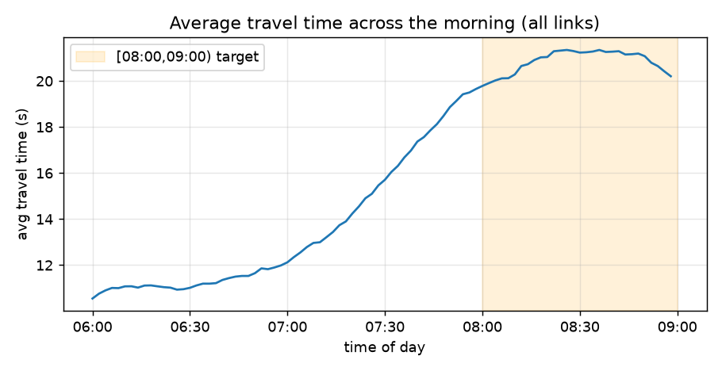
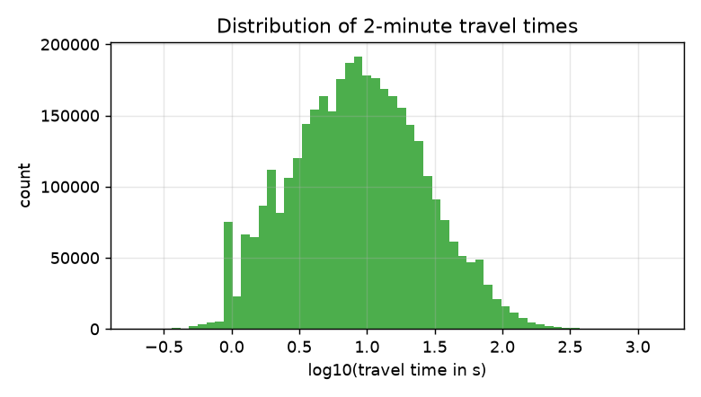
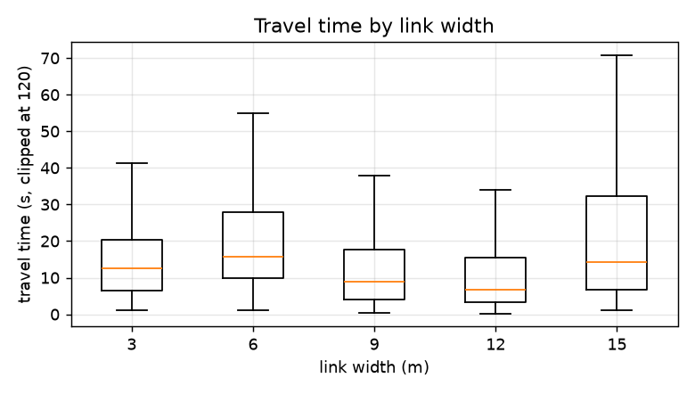
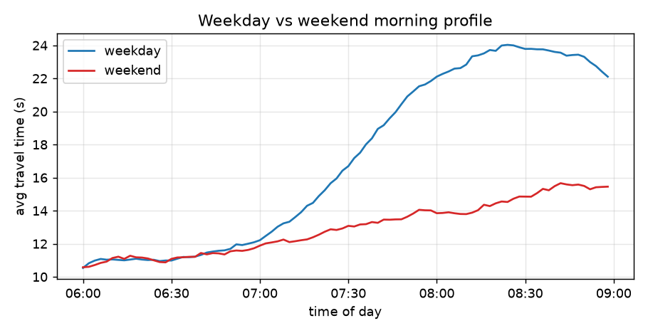
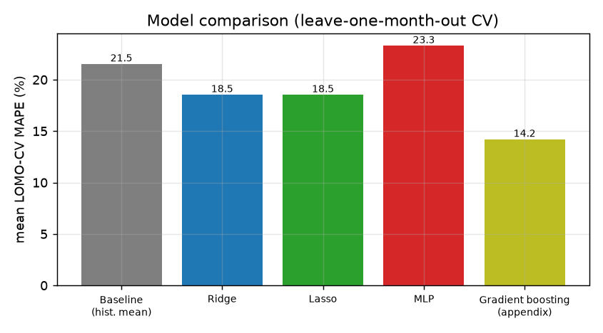
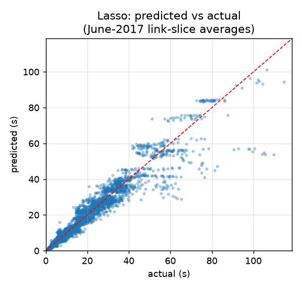
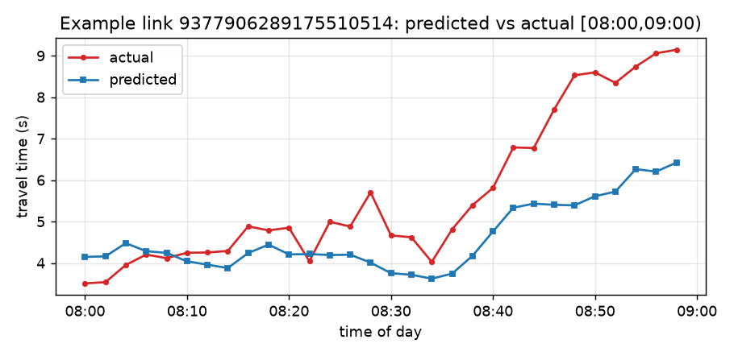

# Vehicle Travel Time Prediction

**Course:** Machine Learning Fundamentals — Final Practical Assignment

**Authors:** Angel Miwa · Miroslava Lange · Maximo Fox

**Date:** 2026/06/25

---

## 1. Introduction

The goal of this assignment is to predict urban traffic conditions from large-scale, fused
location data. Concretely, we are given the historical average travel times of 132 key road
segments ("links") of a city, recorded in 2-minute intervals, together with the static
attributes of each link and the upstream/downstream topology of the road network. The task is
to **predict the average travel time of every 2-minute slice in the window [08:00, 09:00) for
June 2017**, the morning rush hour that follows the period [06:00, 08:00) that is provided as
input.

Accurate short-horizon travel-time prediction supports route planning, congestion
anticipation and intelligent traffic management. From a machine-learning point of view it is a
**regression** problem evaluated with the **Mean Absolute Percentage Error (MAPE)**.

This report follows the canonical pipeline studied in Chapter 1 of the course: raw data →
cleaning and feature engineering → train/validation/test split → model training and tuning →
a single final evaluation on held-out data. We deliberately restrict ourselves to the methods
covered in the course (linear regression with L1/L2 regularisation, a feed-forward neural
network, standardisation, cross-validation and grid search) and avoid techniques that were not
part of the syllabus.

## 2. Data

Three sources are provided. Their fields are summarised below.

| File | Description |
|---|---|
| gy_link_info.txt | Static attributes of each link: link_ID, length (m), width (m), link_class |
| gy_link_top.txt | Topology: for each link, its direct upstream (in_links) and downstream (out_links) links, separated by `#` |
| gy_link_travel_time_part{1,2,3}.zip | Historical travel times: link_ID, date, time_interval (a 2-minute slice) and travel_time (seconds) |

The travel-time archives are large (~2 GB uncompressed, about 26 million rows). Since the task
only concerns the morning, we stream the files in chunks and keep only the rows whose slice
starts in [06:00, 09:00), reducing the working set to about 3.6 million rows. While streaming
we also accumulate a per-link daily average. The whole scan is performed once and cached, so
the rest of the pipeline runs in seconds.

Inspecting the data we found that it spans **2016-03 to 2017-07**, somewhat wider than the
period mentioned in the brief. Two facts shaped our design:

* **June 2016 and July 2017 are morning-only** (they contain [06:00, 08:00) but not
  [08:00, 09:00)), so they carry no labels for our target window.
* **June 2017 does contain the [08:00, 09:00) values** in the historical dump. The assignment
  treats them as the quantity to predict; because they are present we are able to report a
  *genuine* held-out test MAPE. We never use them for training or model selection.

## 3. Exploratory data analysis

The average travel time rises steadily from about 06:00, reaching a plateau around 08:20–08:40
before easing slightly towards 09:00 (Figure 1). This confirms that [08:00, 09:00) is the peak
of the morning rush and that the immediately preceding window [06:00, 08:00) is highly
informative about it.

Travel times are strictly positive and strongly right-skewed (Figure 2): most slices are short
(a few seconds) while a small number of long links reach several minutes. This skew is relevant
for MAPE, which is a *relative* error and therefore weights the many short links heavily.

The static attributes carry signal: wider links tend to have shorter travel times (Figure 3),
and `length` correlates positively with travel time. We found that **`link_class` is constant
(= 1) for all 132 links**, so it carries no information and is excluded from the feature set.

Finally, weekdays are clearly busier than weekends during the rush hour (Figure 4), which
motivates including calendar context in the model.

## 4. Problem framing

The evaluation metric sums over links and time slices,

> MAPE = ( Σ_i Σ_j |ttp_{i,j} − ttr_{i,j}| / ttr_{i,j} ) / ( Σ_i T_i ),

i.e. it is computed over a **monthly-averaged profile**: one value per (link, slice). We
therefore build the supervised problem at exactly that granularity. For every month we compute
the average morning profile of each link, and we create one example per **(month, link, target
slice)** whose target is the month's average travel time for that slice in [08:00, 09:00).

This matters: predicting a *monthly average* is a much smoother task than predicting a single
day, and the per-(link, slice) historical average is a strong baseline. Validating at the
right granularity avoids over-optimistic or over-pessimistic estimates.

**Data splits.** The labelled training months are 2016-03/04/05 and 2017-03/04/05 (six months,
since June 2016 has no labels). June 2017 is the test month and is touched only once, for the
final evaluation. To compare models we use **leave-one-month-out cross-validation** over the
six training months: this gives a robust estimate that respects the temporal, month-level
structure of the problem and never lets a month inform itself. In every fold the historical
features are **rebuilt from the five remaining months only**, so the validation month cannot
reach the features of the training rows either (see §8, *Leakage control*).

## 5. Feature engineering

Each example is described by the following features.

| Group | Features |
|---|---|
| Static | length, width |
| Context | target slice index, month number, year |
| Month morning signal [06:00,08:00) | mean, first-30-min mean, last-30-min mean, last-10-min mean, trend (last−first), std, value one hour earlier |
| Historical | leave-one-month-out mean for this (link, slice); neighbour mean from the topology |

Two design choices are central:

* **Leave-one-month-out historical mean.** For each (link, slice) we compute the average target
  over the *other* months. This is the single most predictive feature and also defines our
  baseline. (The clock minute of the slice is not a separate feature: it equals
  08:00 + 2 × slice index, so it would only duplicate a column.) The neighbour feature averages this quantity over the link's upstream/downstream
  neighbours (from the topology), capturing spatial correlation.

* **Multiplicative-correction target.** Instead of regressing the raw travel time, the models
  learn the correction factor **r = travel_time / historical_mean** and we recover the
  prediction as `ŷ = r̂ × historical_mean`. Because the historical mean is already accurate,
  the model only has to learn how a given month *deviates* from its historical norm (for
  example the systematic difference between 2016 and 2017 traffic). The target r is centred
  near 1, which keeps it well-scaled for linear regression, and — since the historical mean
  cancels — the MAPE on the travel time equals the MAPE on r. This lets us select
  hyper-parameters with a MAPE criterion that optimises the competition metric directly.

All numeric features are standardised (zero mean, unit variance) before the linear models and
the neural network, as discussed in the course for scale-sensitive methods.

**Scope.** In keeping with the course syllabus we use only feature engineering and the models
listed below. We deliberately do **not** use decision trees, random forests or gradient
boosting (not covered in the course), nor dedicated time-series models such as ARIMA; the
temporal information is incorporated as plain engineered features.

## 6. Models

We compare four models from the course, all predicting the correction factor r:

* **Baseline** — predict the historical mean, i.e. r = 1. No learning.
* **Ridge regression** — linear model with L2 regularisation; `alpha` chosen by 5-fold
  cross-validated MAPE.
* **Lasso regression** — linear model with L1 regularisation (induces sparsity); `alpha`
  chosen the same way.
* **Multi-Layer Perceptron (MLP)** — a small feed-forward neural network (two hidden layers of
  64 and 32 ReLU units, Adam optimiser, L2 weight decay, early stopping), as covered in
  Chapter 8.

## 7. Results

**Model comparison (leave-one-month-out cross-validation).**

| Model | Mean MAPE (%) | MAE (s) | R² |
|---|---|---|---|
| Baseline (historical mean) | 21.53 | 4.671 | 0.812 |
| Ridge | 18.55 | 3.626 | 0.906 |
| **Lasso** | **18.54** | 3.598 | 0.909 |
| MLP | 23.30 | 4.366 | 0.893 |

The two linear models clearly improve on the baseline and, notably, **outperform the more
complex neural network**. This is consistent with the bias-variance discussion of Chapter 1:
with only six labelled months, the lower-variance linear models generalise better than the
MLP, whose per-month MAPE swings between 15% and 30%.

**Ridge and Lasso are tied.** Their mean MAPE differs by 0.01 points, far below the
month-to-month spread, and the selected `alpha = 0.001` means the L1 penalty is barely active.
We keep Lasso because it is formally the lowest and its sparsity makes it marginally easier to
read, but the honest conclusion is that *a regularised linear model* is the right choice here,
not that Lasso beats Ridge.

**Final evaluation on the June 2017 test month.** The selected Lasso model is retrained on all
six training months and evaluated once against the actual June 2017 profile.

| Model | MAPE (%) | MAE (s) | RMSE (s) | R² |
|---|---|---|---|---|
| Baseline (historical mean) | 16.99 | 3.581 | 7.351 | 0.879 |
| **Lasso (ours)** | **13.62** | **2.836** | **5.837** | **0.924** |

On the held-out test month our model reaches a **MAPE of 13.62%**, a reduction of about 3.4
percentage points (≈20% relative) over the strong historical-average baseline, while also
lowering MAE and RMSE and raising R² to 0.92. The predicted-versus-actual scatter (Figure 6)
shows points tightly clustered around the diagonal across the whole range of travel times.

**Why the test MAPE (13.6%) is lower than the CV MAPE (18.5%).** A test score better than the
validation score usually signals a problem, so we checked it. The gap is not produced by the
model: the *baseline*, which learns nothing, drops by the same amount (21.5% → 17.0%). The
per-month CV results show where it comes from:

| Validation month | 2016-03 | 2016-04 | 2016-05 | 2017-03 | 2017-04 | 2017-05 |
|---|---|---|---|---|---|---|
| Baseline MAPE (%) | 16.99 | 18.58 | 16.77 | 25.55 | 25.06 | 26.26 |
| Lasso MAPE (%) | 18.18 | 20.96 | 19.83 | 17.66 | 17.01 | 17.62 |

Traffic in 2017 is systematically slower than in 2016. When a 2017 month is held out, its
historical mean is built from three 2016 months and only two 2017 months, so it is biased low
and the baseline error jumps to ~25%. For the June 2017 test month the mean uses all six
months, three from each year, and the bias is smaller. The test month is therefore
structurally easier than an average CV fold; the CV figure is the more conservative estimate
of performance on an unseen month.

The same table shows something less flattering: **on the 2016 months Lasso is worse than the
baseline**. All of its gain comes from the 2017 months, i.e. from learning the year-to-year
level shift. With two years of data, that correction is learned from essentially one contrast,
which is the main limitation of this work.

Figure 7 shows the predicted and actual [08:00, 09:00) profile for one representative link: the
model reproduces both the level and the shape of the rush-hour curve.

## 8. Discussion and limitations

* **Why the baseline is strong.** Because we predict a monthly average, day-to-day noise is
  cancelled out and the per-(link, slice) historical mean is already accurate. The value added
  by the models comes from the current month's morning signal and the year/trend context, which
  let them correct the historical norm — this is largest for months that deviate from history.
* **MAPE and small values.** MAPE is dominated by the shortest links, where a small absolute
  error is a large percentage. This is an inherent property of the metric; learning the
  multiplicative correction (rather than the raw value) mitigates it.
* **Missing links.** Two of the 132 links have no June 2017 records at all; for them we fall
  back to the historical-average prediction so that all 132 × 30 = 3,960 outputs are produced.
* **Assumption.** We predict, and evaluate against, the *monthly-averaged* profile, consistent
  with the metric definition and with the way the June [06:00, 08:00) input is described.
* **Leakage control.** The historical feature uses a leave-one-month-out scheme, and the final
  June test month is never used for training or model selection. A first version of the
  pipeline computed the leave-one-month-out means once, over all training months, and reused
  them inside the cross-validation. A training row then excluded *its own* month but still
  contained the validation month, so the validation labels leaked indirectly into the training
  features. The historical features are now rebuilt in every fold. The fix moved the Lasso CV
  MAPE from 17.97% to 18.54% (MLP 20.64% → 23.30%), i.e. the original CV was about half a
  point optimistic. The test result is unchanged because the test path was already clean. A unit
  test (`test_pipeline.py`) checks that altering the validation month's labels leaves every
  training feature unchanged.
* **Only six labelled months.** All month-level variation the models can learn comes from six
  observations, and `year` takes only two values. The results should be read with that in
  mind.

## 9. Conclusion and future work

We built a complete, course-faithful pipeline for vehicle travel-time prediction. After
streaming and caching ~2 GB of data, engineering features at the monthly-profile granularity,
and comparing models with leave-one-month-out cross-validation, our selected **Lasso regression
on a multiplicative-correction target** predicts the June 2017 [08:00, 09:00) profile with a
**MAPE of 13.62%**, clearly beating both the historical-average baseline and a neural network.

Appendix A shows that gradient-boosted trees, which were outside the course, reduce the test
MAPE further to 11.4%. Other possible extensions, still within the scope of the course, include
sequence models such as
**LSTM/GRU** (Chapter 8) to exploit the fine-grained temporal structure of each day, and a
graph-aware treatment of the topology. We kept to simpler, well-understood models because they
were the most reliable and interpretable choice for this task.

## Appendix A — Gradient-boosted trees (outside the course)

To check how much the course restriction costs, we ran scikit-learn's
`HistGradientBoostingRegressor` (absolute-error loss, early stopping) through exactly the same
protocol: same features, same ratio target, same per-fold leave-one-month-out CV and the same
single evaluation on June 2017. It never took part in model selection and the submission still
uses Lasso.

| Model | CV MAPE (%) | Test MAPE (%) | Test MAE (s) | Test R² |
|---|---|---|---|---|
| Baseline (historical mean) | 21.53 | 16.99 | 3.581 | 0.879 |
| Lasso (selected) | 18.54 | 13.62 | 2.836 | 0.924 |
| Gradient boosting | **14.21** | **11.36** | **2.582** | **0.927** |

Boosting is better on all six CV months, including the 2016 months where Lasso loses to the
baseline (e.g. 2016-05: 15.4% vs 19.8%). Trees can model interactions, such as a correction that
depends on both link width and the morning trend, which a linear model on these features cannot
express. Within the course syllabus, adding hand-built interaction terms to the linear model is
the closest equivalent.

## References

* Course material: *Machine Learning Fundamentals — Complete Bibliography* (provided HTML), in
  particular Chapter 1 (ML pipeline, bias-variance, evaluation metrics, regularisation,
  cross-validation) and Chapter 8 (neural networks, MLP, backpropagation, Adam, ReLU).
* scikit-learn: Ridge, Lasso, MLPRegressor, StandardScaler, GridSearchCV.
